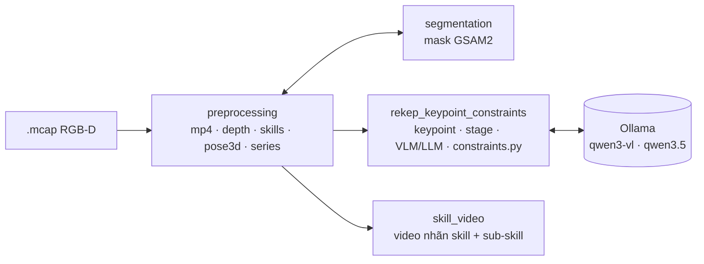

# Video RGB-D → ReKep-style keypoint constraints

Repo này gom **toàn bộ code** cần để chạy pipeline sinh ràng buộc keypoint kiểu ReKep từ video người làm mẫu (ROS 2 bag `.mcap` có RGB + depth). Repo **không kèm dữ liệu**: bạn tự cung cấp video RGB-D.

Tài liệu chi tiết của pipeline chính (thuật toán, tham số, đầu ra, giới hạn) nằm ở [`rekep_keypoint_constraints/README.md`](rekep_keypoint_constraints/README.md).

## Cấu trúc

```text
.
├── rekep_keypoint_constraints/   # Pipeline chính: run_pipeline.py + common/ checks/ keypoints/
│                                 #   stages/ constraints/ reports/
├── preprocessing/                # Tiền xử lý video: run_pipeline.py điều phối 7 bước
│   ├── data_io/                  #   .mcap → video màu mp4 + depth .npz
│   ├── skill_inference/          #   nhận dạng skill (Reach, Grasp, Pour…) từ mask tay–vật
│   ├── perception/               #   pose 3D của vật, điểm tiếp xúc
│   └── constraint_inference/     #   measure_series.py (mặt bàn, góc nghiêng) + llm_client.py (Ollama)
├── segmentation/                 # Grounding DINO + SAM2.1: mask vật theo video
├── skill_video/                  # Video gắn nhãn skill + sub-skill (xem skill_video/README.md)
├── video_depthcam/               # (trống) đặt video .mcap của bạn ở đây
├── out/                          # (trống) đầu ra mặc định khi chạy riêng preprocessing/
└── requirements.txt              # phụ thuộc Python cho cả workspace
```

Tên và vị trí các thư mục **phải giữ nguyên**, vì code tham chiếu nhau bằng đường dẫn tương đối. Ví dụ, `rekep_keypoint_constraints` gọi `../preprocessing`, và `preprocessing` gọi `../segmentation`.



## Yêu cầu

- **Hệ điều hành**: Linux. Đã chạy thử trên Ubuntu với Python 3.12.6.
- **GPU NVIDIA**: khuyến nghị cho Grounding DINO + SAM2.1. Đã chạy thử trên RTX 5060 Ti 16 GB.
- **[Ollama](https://ollama.com)**: chạy ở `http://127.0.0.1:11434`.
- **Model HuggingFace**: `facebook/dinov2-base`, `IDEA-Research/grounding-dino-base`, `facebook/sam2.1-hiera-large`.
- **Video**: ROS 2 bag `.mcap` có đủ 3 topic `/camera/camera/color/image_raw`, `/camera/camera/aligned_depth_to_color/image_raw`, `/camera/camera/color/camera_info` (ví dụ quay bằng Intel RealSense qua `realsense2_camera` với `align_depth` bật).

## Cài đặt

```bash
git clone <url-repo> rekep_workspace
cd rekep_workspace

python3.12 -m venv ../venv          # vị trí venv tuỳ ý; ví dụ dưới dùng ../venv
# Cài torch đúng CUDA theo https://pytorch.org trước, rồi:
../venv/bin/pip install -r requirements.txt

# Tải model HF vào cache (rekep_keypoint_constraints chỉ đọc cache, không tự tải)
../venv/bin/python - <<'EOF'
from transformers import (Dinov2Model, AutoProcessor, GroundingDinoForObjectDetection,
                          Sam2VideoModel, Sam2VideoProcessor)
Dinov2Model.from_pretrained("facebook/dinov2-base")
AutoProcessor.from_pretrained("IDEA-Research/grounding-dino-base")
GroundingDinoForObjectDetection.from_pretrained("IDEA-Research/grounding-dino-base")
Sam2VideoProcessor.from_pretrained("facebook/sam2.1-hiera-large")
Sam2VideoModel.from_pretrained("facebook/sam2.1-hiera-large")
EOF

# Model Ollama
ollama pull qwen3-vl:8b-instruct
ollama pull qwen3.5:9b
```

## Kiểm tra môi trường

```bash
../venv/bin/python rekep_keypoint_constraints/checks/preflight.py
```

Repo không kèm dữ liệu demo, nên preflight sẽ báo `THIẾU` cho 4 mục `input demo_mcap/masks/depth/skills`. Đây là bình thường. Ngoài ra, nếu chưa `pull` model `code` (`qwen3.5-coder-ctx:latest`) thì preflight cũng báo thiếu, nhưng pipeline không gọi model này. Các mục còn lại (source, HF cache, Ollama vision/reasoning) phải là `OK`.

## Chạy trên video của bạn

```bash
cp /path/to/your_demo.mcap video_depthcam/

../venv/bin/python rekep_keypoint_constraints/run_pipeline.py video_depthcam/your_demo.mcap \
  --name my_demo \
  --prompt "hand . bottle . cup ." \
  --instruction "Rót chất lỏng từ chai vào cốc, rồi đặt chai trở lại bàn."
```

- `--prompt`: danh từ tiếng Anh viết thường, ngăn bằng ` . `, liệt kê tay và mọi vật cần theo dõi. Nhãn tay phải chứa từ `hand`.
- `--instruction`: không bắt buộc. Nếu bỏ, VLM sẽ tự suy instruction từ video.
- Kết quả nằm trong `rekep_keypoint_constraints/artifacts/my_demo/`:
  - đầu ra upstream ở `upstream/`;
  - kết quả chính: `constraints/constraints.py`, `constraints/constraints_table.md`, `validation/validation.md`;
  - nhật ký chạy: `run_manifest.json`.

Lưu ý: quy tắc chia stage và luật dự phòng hiện **chỉ viết cho tác vụ rót từ một chai vào một vật đích** (chai + cốc, cùng tay). Xem mục *Giới hạn* trong README của `rekep_keypoint_constraints`.

Lệnh `run_pipeline.py` không truyền đối số sẽ chạy video demo gốc `video_depthcam/demo_20260912_172945_0.mcap`, cùng các file trung gian của nó trong `out/`. Những file này **không có trong repo**, nên lệnh đó sẽ báo lỗi thiếu file.

## Video gắn nhãn skill + sub-skill

```bash
python skill_video/make_skill_video.py video_depthcam/your_demo.mcap \
  --prompt "hand . plastic water bottle . white cup ."
```

Kết quả nằm ở `skill_video/output/<name>/<name>_skill_video_h264.mp4`. Chi tiết xem [`skill_video/README.md`](skill_video/README.md).

## Xử lý sự cố: `CUDA out of memory` ở bước GSAM2

Sau mỗi lần gọi VLM/LLM, Ollama giữ `qwen3-vl` và `qwen3.5` trong VRAM thêm khoảng 30 phút (tổng ~13–14 GB). Vì vậy lần chạy **kế tiếp** có thể không còn chỗ cho Grounding DINO + SAM2 trên GPU 16 GB. Cách giải phóng (model sẽ tự nạp lại khi cần):

```bash
ollama stop qwen3-vl:8b-instruct; ollama stop qwen3.5:9b
```

## Nguồn gốc các thư mục

| Thư mục | Nguồn |
|---|---|
| `rekep_keypoint_constraints/` | Code của dự án này |
| `preprocessing/` | Lấy từ repo `video_pipeline` (commit `5e2a255`, thư mục `video_pipeline/`). Chỉ giữ 11 file pipeline dùng; `run_pipeline.py` bỏ 4 bước suy luận constraint kiểu cũ (`scene/infer/validate/table`) |
| `skill_video/` | `render_hoi_video.py` lấy từ `visualization/` của repo `video_pipeline` (chỉ đổi đường dẫn import); `make_skill_video.py` viết mới |
| `segmentation/` | Lấy từ repo `sam_dino` (commit `56c8ca5`) **kèm thay đổi chưa commit**: `common.py` đã sửa, thêm `merge_object_ids.py`. Chỉ giữ 3 file pipeline dùng |

## License

Chưa có file license. Hãy thêm `LICENSE` trước khi công khai repo. Model và thư viện bên thứ ba (DINOv2, Grounding DINO, SAM 2, Qwen) có license riêng.
