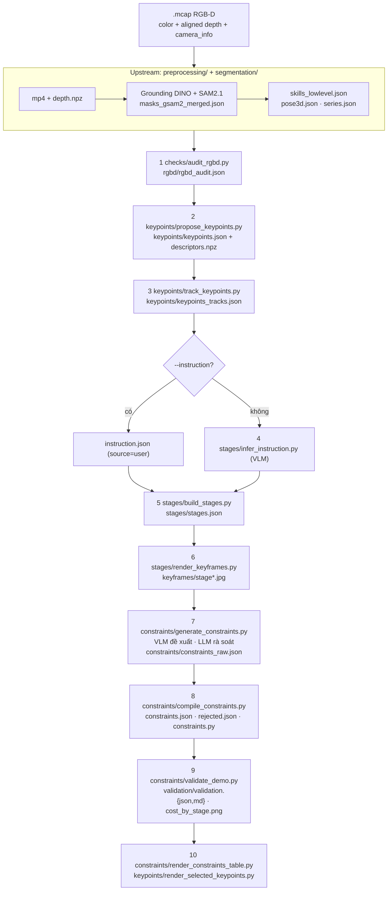

# rekep_keypoint_constraints

Sinh **ràng buộc keypoint theo từng stage** (kiểu [ReKep](#tài-liệu-tham-khảo)) từ **một video người làm mẫu** quay bằng camera RGB-D (ROS 2 bag `.mcap`). Ca thử hiện tại: *rót chất lỏng từ chai vào cốc rồi đặt chai lại bàn*.

Đầu ra cuối là một file Python `constraints.py` chứa các hàm cost `f(end_effector, keypoints) → float`, với quy ước **cost ≤ 0 nghĩa là thỏa**. Kèm theo là bảng constraint dễ đọc và báo cáo kiểm tra trên video.

> Trạng thái: nghiên cứu/thử nghiệm. Ngưỡng được hiệu chuẩn từ **chính video mẫu**, toạ độ ở **hệ camera màu** (chưa hiệu chuẩn sang hệ robot). Chưa dùng để điều khiển robot. Xem [Giới hạn](#giới-hạn-và-hướng-phát-triển).

---

## Mục lục

1. [Tổng quan và mục tiêu](#tổng-quan-và-mục-tiêu)
2. [Tính năng chính](#tính-năng-chính)
3. [Kiến trúc và luồng dữ liệu](#kiến-trúc-và-luồng-dữ-liệu)
4. [Cấu trúc thư mục](#cấu-trúc-thư-mục)
5. [Yêu cầu và phụ thuộc](#yêu-cầu-và-phụ-thuộc)
6. [Cài đặt và cấu hình](#cài-đặt-và-cấu-hình)
7. [Sử dụng](#sử-dụng)
8. [Chi tiết triển khai và thuật toán](#chi-tiết-triển-khai-và-thuật-toán)
9. [Kiểm tra và xử lý sự cố](#kiểm-tra-và-xử-lý-sự-cố)
10. [Giới hạn và hướng phát triển](#giới-hạn-và-hướng-phát-triển)
11. [License và tài liệu tham khảo](#license-và-tài-liệu-tham-khảo)

---

## Tổng quan và mục tiêu

ReKep biểu diễn một thao tác robot bằng chuỗi stage. Mỗi stage có các ràng buộc giữa keypoint 3D trên vật:

- **subgoal**: phải đúng ở **cuối** stage (ví dụ: cuối stage rót, trục chai nghiêng ≥ 86° so với ban đầu);
- **path**: phải đúng **suốt** stage (ví dụ: khi mang chai tới cốc, chai giữ gần thẳng).

Bài báo gốc dùng VLM để sinh ràng buộc từ một instruction và một ảnh. Thư mục này thử cách khác: **suy ràng buộc từ video làm mẫu**. Keypoint được đề xuất và theo dõi trên video, stage được chia theo skill quan sát được, VLM/LLM đề xuất và rà soát quan hệ. Cuối cùng, ngưỡng số được **đo trên video** thay vì để model đoán.

Mục tiêu:

1. Từ một file `.mcap` RGB-D, chạy **một lệnh** ra keypoint, stage, constraint và báo cáo.
2. Mọi luật đều có **nguồn gốc rõ ràng** (`vlm_candidate` hay `geometry_policy_fallback`), ngưỡng có **số đo gốc**, và trạng thái kiểm chứng.
3. **Không thực thi mã do model viết**: model chỉ trả JSON theo schema, mã cost được sinh từ template DSL.

## Tính năng chính

| Tính năng | Script |
|---|---|
| Kiểm tra RGB-D: số frame, nội tham số, độ phủ depth theo vật, sai số chiếu lại, ảnh overlay | `checks/audit_rgbd.py` |
| Đề xuất keypoint kiểu ReKep: DINOv2 → PCA 3D + XYZ → K-means → Mean Shift 3D | `keypoints/propose_keypoints.py` |
| Theo dõi keypoint qua video (optical flow Lucas–Kanade + bắt lại bằng DINOv2), thêm 2 điểm trục chai suy ra từ pose 3D | `keypoints/track_keypoints.py` |
| Suy instruction từ 4 frame bằng VLM (luôn đánh dấu cần duyệt), hoặc nhận instruction từ người dùng | `stages/infer_instruction.py` |
| Ánh xạ skill mức thấp → stage ReKep; tách stage *Pour* tại đỉnh góc nghiêng đo được | `stages/build_stages.py` |
| Vẽ keyframe đầu/giữa/cuối mỗi stage có ID keypoint, kèm QA | `stages/render_keyframes.py` |
| VLM đề xuất ≤ 3 constraint/stage; LLM rà soát accept/reject | `constraints/generate_constraints.py` |
| Lọc ngữ nghĩa, bổ sung luật dự phòng, hiệu chuẩn ngưỡng từ video, sinh `constraints.py` | `constraints/compile_constraints.py` |
| Đo cost trên video + phản chứng hình học cho từng luật, vẽ đồ thị cost | `constraints/validate_demo.py` |
| Bảng Markdown constraint; ảnh chỉ những keypoint thực sự được dùng | `constraints/render_constraints_table.py`, `keypoints/render_selected_keypoints.py` |
| Kiểm tra môi trường (file, HF cache, Ollama) mà không chạy suy luận | `checks/preflight.py` |

## Kiến trúc và luồng dữ liệu

### Luồng chính (RGB-D)



`run_pipeline.py` chạy tuần tự các bước trên. Mỗi bước là một subprocess và ghi log riêng `<out>/<step>.log`. Toàn bộ thời gian, mã thoát và đường dẫn được ghi vào `<out>/run_manifest.json`. Nếu một bước lỗi, pipeline dừng ngay và manifest ghi `status=failed` cùng `failed_step`.

### Model và vai trò

| Vai trò | Model | Dùng ở |
|---|---|---|
| Đặc trưng thị giác cho keypoint | `facebook/dinov2-base` (HF, `local_files_only=True`) | `keypoints/propose_keypoints.py`, `keypoints/track_keypoints.py` |
| Mask vật | Grounding DINO base + SAM2.1 hiera-large | Upstream (`segmentation/gsam2_video.py`) |
| `vision`: instruction, đề xuất constraint | `qwen3-vl:8b-instruct` (Ollama) | `stages/infer_instruction.py`, `constraints/generate_constraints.py` |
| `reasoning`: rà soát ứng viên | `qwen3.5:9b` (Ollama) | `constraints/generate_constraints.py` |
| `code` | `qwen3.5-coder-ctx:latest` | Chỉ khai báo trong `config.json`, **không được gọi**: mã cost sinh bằng template |

Lệnh gọi Ollama đi qua `model_client.call_role()`. Hàm này dùng lại `llm_client` của pipeline cũ, có **cache theo hash request** tại `artifacts/cache/`, nên chạy lại cùng prompt sẽ không gọi model lần nữa.

### Hệ toạ độ và đơn vị

- XYZ tính bằng **mm trong hệ camera màu** (`rgbd.RGBDSequence.backproject`), *không* phải hệ robot.
- Góc tính bằng độ.
- ID `-1` là **end-effector**. Video không có toạ độ end-effector, nên luật dùng `-1` luôn có trạng thái `unverifiable_no_end_effector_track`.

## Cấu trúc thư mục

```text
rekep_keypoint_constraints/
├── run_pipeline.py                  # Một lệnh: .mcap → keypoint → stage → constraint → báo cáo
├── config.json                      # URL Ollama, tên model, input demo, module upstream cần có
├── requirements.txt
│
├── common/                          # Thư viện dùng chung (import, không chạy trực tiếp)
│   ├── rgbd.py                      #   RGBDSequence: đọc mp4 + depth.npz + mask RLE, chiếu 2D↔3D
│   ├── model_client.py              #   call_role("vision"|"reasoning"|"code", ...) → Ollama, có cache
│   └── constraint_runtime.py        #   measure()/evaluate(): DSL → cost có dấu (≤0 là thỏa)
│
├── checks/                          # Kiểm tra môi trường và dữ liệu
│   ├── preflight.py                 #   File/HF cache/Ollama, không chạy model
│   └── audit_rgbd.py                #   Bước 1: kiểm tra RGB-D
│
├── keypoints/                       # Keypoint
│   ├── propose_keypoints.py         #   Bước 2: đề xuất
│   ├── track_keypoints.py           #   Bước 3: theo dõi + điểm trục pose 3D
│   └── render_selected_keypoints.py #   Bước 10b: ảnh điểm được constraint dùng
│
├── stages/                          # Instruction và stage
│   ├── infer_instruction.py         #   Bước 4: VLM suy instruction
│   ├── build_stages.py              #   Bước 5: skill → stage
│   └── render_keyframes.py          #   Bước 6: ảnh keyframe + QA
│
├── constraints/                     # Sinh và kiểm tra constraint
│   ├── generate_constraints.py      #   Bước 7: VLM đề xuất, LLM rà soát
│   ├── compile_constraints.py       #   Bước 8: lọc, hiệu chuẩn ngưỡng, sinh constraints.py
│   ├── validate_demo.py             #   Bước 9: cost trên video + phản chứng
│   └── render_constraints_table.py  #   Bước 10a: bảng Markdown
│
├── reports/                         # Tiện ích làm slide báo cáo (cần python-pptx)
│   ├── tidy_ppt_baocao.py
│   └── create_comparison_slide.py
│
└── artifacts/                       # (bị .gitignore) mọi đầu ra + cache VLM/LLM
```

Mọi script đều chạy trực tiếp được bằng `python <thư mục>/<file>.py`. Mỗi script tự thêm gốc repo vào `sys.path` rồi import mã dùng chung qua gói `rekep_keypoint_constraints.common.*`.

### Vị trí trong workspace (bắt buộc)

Code dùng **đường dẫn tương đối tới thư mục cha** (`ROOT = Path(__file__).parent.parent`), nên thư mục này phải nằm cạnh các thư mục sau. Repo gốc đã có sẵn bố cục này:

```text
<gốc repo>/                              # ROOT
├── rekep_keypoint_constraints/          # thư mục này
├── preprocessing/                       # tiền xử lý: mcap→mp4/depth, skill, pose3d, series, llm_client
├── segmentation/                        # Grounded-SAM2: gsam2_video.py, merge_object_ids.py
├── video_depthcam/                      # (trống) video đầu vào (.mcap) — không kèm trong repo
└── out/                                 # (trống) đầu ra upstream mặc định — không kèm trong repo
```

File `constraints.py` sinh ra import `rekep_keypoint_constraints.common.constraint_runtime`, nên muốn import nó thì gốc repo phải nằm trong `PYTHONPATH`.

Repo **không kèm dữ liệu demo** (`video_depthcam/demo_20260912_172945_0.mcap` và các file trong `out/`). Các lệnh chạy mặc định không truyền đường dẫn (mục *Demo mặc định*, *Chạy từng bước*) chỉ chạy được khi bạn có các file đó. Với video của bạn, dùng cách ở mục [Video `.mcap` RGB-D khác](#4-video-mcap-rgb-d-khác).

## Yêu cầu và phụ thuộc

| Thành phần | Yêu cầu | Đã thử |
|---|---|---|
| Python | 3.12 | 3.12.6 |
| GPU | Không bắt buộc; DINOv2 tự dùng CUDA nếu có | NVIDIA RTX 5060 Ti 16 GB, torch 2.14 + CUDA 13.0 |
| Ollama | Chạy tại `http://127.0.0.1:11434`, đã `pull` các model trong `config.json` | `qwen3-vl:8b-instruct`, `qwen3.5:9b` |
| HuggingFace cache | `~/.cache/huggingface/hub` có `facebook/dinov2-base` (và Grounding DINO, SAM2.1 cho upstream) | — |
| Upstream | `preprocessing/` và `segmentation/` (có sẵn trong repo) | — |

[`requirements.txt`](requirements.txt) của thư mục này chỉ gồm package mà riêng nó cần: `numpy`, `opencv-python`, `torch`, `transformers`, `scikit-learn`, `matplotlib`, `mcap`, `requests`. Khi chạy cả upstream, dùng [`requirements.txt` ở gốc repo](../requirements.txt), vì file đó có thêm `mcap-ros2-support`, `mediapipe`, `PyYAML`, `Pillow`, `pytest`. Gói `python-pptx` là tuỳ chọn, chỉ cần cho hai script tạo slide.

## Cài đặt và cấu hình

Hướng dẫn đầy đủ (gồm tải Grounding DINO và SAM2.1) nằm ở [README gốc repo](../README.md). Tóm tắt, chạy từ gốc repo:

```bash
# 1–2. Môi trường Python
python3.12 -m venv ../venv
# Cài torch đúng CUDA theo pytorch.org trước, rồi:
../venv/bin/pip install -r requirements.txt

# 3. Tải model HF vào cache (code chỉ đọc cache, không tự tải)
../venv/bin/python -c "from transformers import Dinov2Model; Dinov2Model.from_pretrained('facebook/dinov2-base')"

# 4. Model Ollama
ollama pull qwen3-vl:8b-instruct
ollama pull qwen3.5:9b

# 5. Kiểm tra
../venv/bin/python rekep_keypoint_constraints/checks/preflight.py            # có Ollama
../venv/bin/python rekep_keypoint_constraints/checks/preflight.py --offline  # chỉ file + HF cache
```

### `config.json`

| Khoá | Ý nghĩa |
|---|---|
| `ollama_base_url` | URL server Ollama |
| `models.vision` / `reasoning` / `code` | Tên model Ollama cho từng vai trò trong `call_role()` |
| `hf_models` | Model HF mà `preflight.py` kiểm tra trong cache |
| `inputs` | File demo mà `preflight.py` kiểm tra (đường dẫn tương đối so với thư mục này) |
| `source_modules` | Module upstream bắt buộc phải tồn tại |

Lưu ý: `preflight.py` kiểm tra **mọi** model trong `models`, kể cả `code` dù pipeline không gọi model này. Nếu chưa có model `code`, preflight sẽ báo `THIẾU`, nhưng pipeline vẫn chạy được.

## Sử dụng

Các lệnh dưới đây chạy từ `video_pipeline_ai/`.

### 1. Demo mặc định (dùng lại upstream có sẵn trong `out/`)

```bash
../venv/bin/python rekep_keypoint_constraints/run_pipeline.py
```

Lệnh này dùng `video_depthcam/demo_20260912_172945_0.mcap` và đọc các file đã tính sẵn trong `out/` (`mp4/demo_color.mp4`, `npz/demo_depth.npz`, `gsam2_demo/masks_gsam2_merged.json`, `json/skills_lowlevel.json`, `json/demo_pose3d.json`, `json/demo_series.json`). Nó **không ghi đè** `out/`. Kết quả nằm trong `rekep_keypoint_constraints/artifacts/demo/`.

### 2. Tự cấp instruction (bỏ bước VLM suy instruction)

```bash
../venv/bin/python rekep_keypoint_constraints/run_pipeline.py \
  --instruction "Rót chất lỏng từ chai vào cốc, rồi đặt chai trở lại bàn."
```

### 3. Thư mục kết quả riêng và tham số keypoint

```bash
../venv/bin/python rekep_keypoint_constraints/run_pipeline.py \
  --out rekep_keypoint_constraints/artifacts/demo_rekep_style \
  --num-candidates-per-mask 5 --merge-distance-mm 35
```

### 4. Video `.mcap` RGB-D khác

```bash
../venv/bin/python rekep_keypoint_constraints/run_pipeline.py /path/to/video.mcap \
  --name other_demo --prompt "hand . bottle . cup ." \
  --instruction "Rót chất lỏng từ chai vào cốc."
```

File MCAP phải có đủ 3 topic: `/camera/camera/color/image_raw`, `/camera/camera/aligned_depth_to_color/image_raw` và `/camera/camera/color/camera_info`. Pipeline cũ được gọi với `--to series` để tạo upstream trong `artifacts/<name>/upstream/`. `--prompt` là bắt buộc với video mới.

### Tham số `run_pipeline.py`

| Tham số | Mặc định | Ý nghĩa |
|---|---|---|
| `mcap` (vị trí) | `video_depthcam/demo_20260912_172945_0.mcap` | File đầu vào |
| `--name` | `demo` hoặc tên file | Tên ngắn cho thư mục kết quả |
| `--prompt` | — | Nhãn vật cho Grounded-SAM2 (bắt buộc với video mới) |
| `--instruction` | — | Instruction của người dùng; bỏ qua `stages/infer_instruction.py` |
| `--num-candidates-per-mask` | `5` | Số cụm K-means ban đầu trên mỗi vật |
| `--merge-distance-mm` | `35` | Bandwidth Mean Shift 3D để gộp điểm gần nhau |
| `--out` | `artifacts/<name>` | Thư mục kết quả |

### Chạy từng bước

Mọi script đều có `--help`, và mặc định trỏ tới đường dẫn demo. Ví dụ chạy lại riêng bước biên dịch và kiểm tra:

```bash
B=rekep_keypoint_constraints/artifacts/demo
../venv/bin/python rekep_keypoint_constraints/constraints/compile_constraints.py \
  --raw $B/constraints/constraints_raw.json --stages $B/stages/stages.json \
  --tracks $B/keypoints/keypoints_tracks.json --series out/json/demo_series.json \
  --out $B/constraints
../venv/bin/python rekep_keypoint_constraints/constraints/validate_demo.py \
  --constraints $B/constraints/constraints.json --stages $B/stages/stages.json \
  --tracks $B/keypoints/keypoints_tracks.json --out $B/validation
```

`propose_keypoints.py` có thêm `--frame` (frame tham chiếu, mặc định 0) và `--workspace-bounds-mm XMIN YMIN ZMIN XMAX YMAX ZMAX` (loại điểm ngoài vùng làm việc; để trống khi chưa hiệu chuẩn).

### Đầu ra (trong `<out>/`)

| File | Nội dung |
|---|---|
| `run_manifest.json`, `<step>.log` | Thời gian, mã thoát, log từng bước; `validation_summary` khi xong |
| `rgbd/rgbd_audit.json`, `rgbd/rgb_depth_overlay.png` | Kiểm tra RGB-D |
| `keypoints/keypoints.json` | Keypoint đề xuất: `id`, `object_label`, `region`, `pixel_uv`, `xyz_mm`, `source` |
| `keypoints/rejected_candidates.json` | Ứng viên bị loại (sát bàn, ngoài vùng, bị gộp) và lý do |
| `keypoints/keypoints_tracks.json` | Trạng thái từng điểm theo frame (`visible` / `occluded` / `invalid` / `inferred`) |
| `keypoints/keypoints_preview.png`, `keypoints_used*.{json,png}` | Ảnh điểm đề xuất và điểm thực sự được constraint dùng |
| `stages/instruction.json`, `stages/stages.json` | Instruction và stage, kèm ID đủ điều kiện cho path/subgoal |
| `keyframes/stage*.jpg`, `render_qa.json`, `keypoint_legend.json` | Ảnh keyframe và QA |
| `constraints/constraints_raw.json`, `stage*_prompt.txt`, `*_raw.txt` | Ứng viên VLM, nhận xét LLM, prompt và phản hồi thô |
| `constraints/constraints.json`, `rejected.json` | Luật được chấp nhận (ngưỡng, nguồn, số đo) và luật bị loại |
| `constraints/constraints.py` | Hàm cost sinh tự động, ví dụ `stage3_subgoal_constraint1(end_effector, keypoints)` |
| `constraints/constraints_table.md` | Bảng constraint dễ đọc |
| `validation/validation.{json,md}`, `cost_by_stage.png` | Độ phủ, tỉ lệ vi phạm, phản chứng, đồ thị cost |

Ví dụ dùng `constraints.py`:

```python
# chạy từ video_pipeline_ai/ để import được rekep_keypoint_constraints
import importlib.util, numpy as np
spec = importlib.util.spec_from_file_location(
    "c", "rekep_keypoint_constraints/artifacts/demo/constraints/constraints.py")
c = importlib.util.module_from_spec(spec); spec.loader.exec_module(c)
keypoints = np.zeros((14, 3))         # (N, 3) mm, chỉ số = ID keypoint
cost = c.stage3_subgoal_constraint1(None, keypoints)  # ≤ 0 là thỏa
```

## Chi tiết triển khai và thuật toán

### Bước 2: Đề xuất keypoint (`propose_keypoints.py`)

Với mỗi mask vật (bỏ qua nhãn chứa `hand`, vì ReKep dùng end-effector riêng):

1. Lấy tối đa **1600 pixel** trong mask có depth hợp lệ, rồi back-project ra XYZ.
2. Tính feature map DINOv2-base cho frame tham chiếu và lấy mẫu song tuyến tại các pixel đó.
3. Giảm đặc trưng bằng **PCA còn 3 chiều**, chuẩn hoá từng cột về [0,1], rồi ghép với **XYZ đã chuẩn hoá**, được vector 6 chiều.
4. Chạy **K-means** (`--num-candidates-per-mask` cụm). Mỗi cụm chọn pixel thật gần tâm cụm nhất trong không gian đặc trưng.
5. Loại ứng viên **sát mặt bàn**: cao < 25 mm, hoặc nằm ở 1/4 dưới bbox và cao < 55% chiều cao vật. Mặt bàn lấy từ `series.table_plane`.
6. **Mean Shift trên XYZ thật** (bandwidth = `--merge-distance-mm`) để gộp các điểm gần nhau.
7. Gán nhãn vùng `top` (điểm cao nhất trong ảnh) và `center` (gần trung vị mask) **sau khi chọn điểm**. Hai nhãn này chỉ là gợi ý 2D để luật dự phòng tìm điểm tham chiếu.

ReKep dùng bandwidth 80 mm. Trên demo chai/cốc nhỏ, 80 mm làm mỗi vật chỉ còn một điểm, nên mặc định ở đây là 35 mm.

### Bước 3: Theo dõi (`track_keypoints.py`)

- **Vật đứng yên** (bbox dao động < 12 px suốt video): giữ pixel tham chiếu (`static_anchor`). Điểm được coi là còn thấy nếu depth chênh ≤ 30 mm.
- **Vật di chuyển**: dùng optical flow Lucas–Kanade (cửa sổ 21×21, 3 tầng pyramid). Điểm bị coi là mất dấu khi nhảy > 35 px, lỗi flow > 35, ra ngoài mask, mất depth, hoặc nhảy depth > 70 mm.
- **Bắt lại** (mỗi 5 frame với điểm đã mất): tìm pixel trong mask có cosine similarity DINOv2 cao nhất với descriptor gốc, có phạt theo khoảng cách. Chỉ chấp nhận khi similarity ≥ 0.78 và cách vị trí dự đoán ≤ 100 px.
- **Điểm trục từ pose 3D**: với vật có `axis_confident`, thêm 2 điểm `center ± 60 mm · axis` (`region = axis_positive/axis_negative`, `status = inferred`, `source = pose3d_axis`). Đây là điểm ước lượng, không phải điểm bề mặt nhìn thấy.

### Bước 5: Chia stage (`build_stages.py`)

| Skill mức thấp | Stage |
|---|---|
| Reach, Contact, Grasp | `grasp` |
| Lift, MoveToTarget (trước Pour) | `transport_to_target` |
| Pour | Tách tại **frame có góc nghiêng lớn nhất** thành `tilt_to_pour` + `restore_upright` (nếu đỉnh cách hai đầu > 10 frame) |
| MoveToTarget, Place, Release (sau Pour) | `return_place` |
| Retract | `retract` (chỉ quan sát, không sinh constraint) |

Điều kiện ID đủ cho từng phase:

- **path**: điểm khả dụng ≥ 90% số frame của stage, và có mặt ở cả 3 keyframe.
- **subgoal**: điểm khả dụng ≥ 60% trong 5 frame cuối của stage.

### Bước 7–8: DSL constraint

Chỉ có 7 phép được hỗ trợ (`constraint_runtime.measure`):

| Phép | Số ID | Đại lượng đo |
|---|---|---|
| `distance_le` / `distance_ge` | 2 | ‖p₀ − p₁‖ (mm) |
| `orientation_change_le` / `_ge` | 2 (cùng vật) | Góc giữa (p₁ − p₀) và vector cùng cặp điểm ở frame 0 (độ) |
| `height_above_table_le` / `_ge` | 1 | Khoảng cách có dấu tới mặt bàn theo pháp tuyến (mm) |
| `distance_to_reference_le` | 1 | Khoảng cách tới vị trí của chính điểm đó ở frame 0 (mm) |

Cost: `_le` → `value − threshold`; `_ge` → `threshold − value`.

`compile_constraints.py` xử lý ứng viên như sau:

1. **Lọc ngữ nghĩa** (`semantic_error`): kiểm tra đúng số ID, ID tồn tại và đủ dữ liệu trong phase. `-1` chỉ được dùng cho subgoal grasp. Phép đo hướng phải dùng cặp trục `pose3d_axis` của vật đang thao tác. Không được đo khoảng cách giữa hai điểm trên cùng một vật. Mỗi stage chỉ cho phép một tập (phase, op) nhất định.
2. **Luật dự phòng** (`FALLBACK`): nếu VLM không đưa ra (phase, op) mong đợi của stage, luật hình học tương ứng được thêm vào với `source = geometry_policy_fallback`.
3. **Hiệu chuẩn ngưỡng** trên video:
   - path: phân vị 95 (`_le`) hoặc 5 (`_ge`); subgoal: trung vị 5 frame cuối;
   - cộng biên 15 mm hoặc 5°;
   - độ phủ tối thiểu 90% (path) / 60% (subgoal);
   - grasp dùng ngưỡng đặt sẵn 30 mm.
4. **Sinh mã**: `constraints.py` chỉ gồm `SPECS` (dữ liệu) và các hàm gọi `evaluate(SPECS[i], ...)`. Không có mã nào do model viết.

### Bước 9: Kiểm tra (`validate_demo.py`)

- Tính cost trên các frame của phase (cả stage với path, 5 frame cuối với subgoal).
- Luật được xếp `pass_demo_and_counterfactual` khi:
  - độ phủ đạt ngưỡng (90% với path, 60% với subgoal);
  - path có tỉ lệ vi phạm ≤ 10%, subgoal có cost trung vị ≤ 0;
  - **phản chứng** đạt, tức cost gốc ≤ 0 < cost sau biến đổi. Phản chứng là thay đổi có chủ đích *đúng* quan hệ đang xét: dịch điểm ra xa thêm ngưỡng + 200 mm, xoay trục khoảng 90°, dịch ±200 mm theo pháp tuyến bàn, hoặc lệch end-effector 100 mm.
- Luật không thoả các điều kiện trên được xếp `needs_review`; luật dùng `-1` được xếp `unverifiable_no_end_effector_track`.

Bước này chỉ kiểm tra **tính nhất quán và dấu của hàm cost**. Nó không chứng minh luật là điều kiện cần cho task.

### Kết quả đã ghi nhận (artifact cục bộ, không có trong repo)

- **Demo cũ** (`artifacts/demo/`, 12 điểm quan sát + 2 điểm trục): 6 stage, 9 luật. Trong đó 8 luật đạt kiểm tra cùng video + phản chứng, 1 luật grasp chưa xác minh được.
- **Bản ReKep-style** (`artifacts/demo_rekep_style/`, 22/10/2026): 5 điểm quan sát (cốc 0–2, chai 3–4) + trục 5–6. Bước VLM bị lỗi vì không kết nối được Ollama trong môi trường chạy (`PermissionError: Operation not permitted`). Ở lần kiểm tra không dùng model, chỉ chạy luật dự phòng: 8 luật, trong đó 7 đạt và 1 grasp không kiểm được.

## Kiểm tra và xử lý sự cố

Repo **chưa có unit test**. Các cách kiểm tra hiện có:

1. **Môi trường**: chạy `preflight.py` (hoặc thêm `--offline`).
2. **Tích hợp không dùng model**: tạo `constraints_raw.json` có `candidates: []` cho mọi stage (chỉ cần các khoá `instruction`, `instruction_review_pending`, `stages[].stage/name/candidates`), rồi chạy `compile_constraints.py` và `validate_demo.py`. Khi đó chỉ luật dự phòng được biên dịch. Cách này đã dùng cho `demo_rekep_style/model_free_check/`.
3. **QA ảnh**: `keyframes/render_qa.json` ghi số điểm path cần mà bị thiếu ở keyframe và số điểm quan sát nằm ngoài mask. Cả hai nên bằng 0.

| Lỗi | Nguyên nhân / cách xử lý |
|---|---|
| `MCAP thiếu topic cần cho RGB-D 3D` | Bag không có depth đã căn màu hoặc camera_info. Pipeline cần video RGB-D; video chỉ có ảnh màu không được hỗ trợ |
| `Video mới cần --prompt ...` | Thêm `--prompt "hand . bottle . cup ."` |
| `Số frame RGB, depth, timestamp và mask không khớp` | Đầu vào upstream không đồng bộ; chạy lại upstream với `--force` trong `preprocessing/run_pipeline.py` |
| `OSError ... local_files_only` khi tải DINOv2 | Model chưa có trong HF cache; tải trước như ở bước cài đặt 3 |
| `KHÔNG KẾT NỐI Ollama` / `Operation not permitted` ở bước `instruction` | Khởi động `ollama serve`, kiểm tra `ollama_base_url`. Nếu sandbox chặn mạng cục bộ, truyền `--instruction` để bỏ bước 4; bước 7 vẫn cần Ollama |
| `Không xác định duy nhất điểm top/center ... cho vật` | Luật dự phòng cần đúng một điểm `top` trên vật đích, một `center` và một cặp trục trên chai; thử đổi `--merge-distance-mm` hoặc `--num-candidates-per-mask` |
| `Cần đúng một vật đích khác vật thao tác` | Mask có nhiều hơn hai vật không phải tay; luật dự phòng hiện chỉ hỗ trợ chai → một vật đích |
| `Bước <x> lỗi, xem <log>` | Xem `<out>/<x>.log` và `run_manifest.json` (`failed_step`) |
| Kết quả VLM không đổi khi sửa ảnh/prompt nhỏ | Cache theo hash request ở `artifacts/cache/`; xoá cache nếu muốn gọi lại model |

## Giới hạn và hướng phát triển

**Giới hạn hiện tại**

- **Chỉ phục vụ tác vụ rót chai → cốc**:
  - quy tắc chia stage, `FALLBACK`, tập (phase, op) hợp lệ và prompt VLM đều viết riêng cho tác vụ này;
  - màu vẽ phân biệt cốc/chai bằng `object_label == "white cup"` hoặc `object_id == 0`.
- **Ngưỡng học từ một video mẫu**: kiểm tra trên chính video đó chỉ là kiểm tra nhất quán, chưa có bằng chứng tổng quát.
- **Điểm trục chai từ pose 3D**: cùng nguồn với dữ liệu dùng để tách stage Pour, nên chưa phải kiểm chứng độc lập.
- **Không có quỹ đạo end-effector**: luật grasp chưa xác minh được.
- **Chưa hiệu chuẩn camera → robot và chưa có giới hạn vùng làm việc**: `--workspace-bounds-mm` để trống mặc định.
- **Khác bản ReKep gốc**: dùng DINOv2-base thay cho ViT-S14 có registers, mask Grounding DINO/SAM2 thay cho SAM, và bandwidth 35 mm. Đây là bản triển khai **theo nguyên lý ReKep**, không tái lập chính xác bài báo.
- **Chưa chạy lại VLM/LLM** cho bộ ID keypoint mới của `demo_rekep_style`.

**Hướng phát triển**

- Đánh giá trên nhiều video RGB-D độc lập; tách tập dữ liệu dùng để hiệu chuẩn ngưỡng khỏi tập dùng để kiểm tra.
- Tổng quát hoá ánh xạ skill → stage và luật dự phòng cho các thao tác khác ngoài rót.
- Hiệu chuẩn extrinsic camera → robot (UR3), thêm workspace bounds và track end-effector để kiểm chứng luật grasp.
- Thêm unit test cho `constraint_runtime`, `semantic_error`, `calibrate`, `build_stages`.
- Bỏ đường dẫn cứng tới thư mục cha (đưa vào `config.json` hoặc biến môi trường) để repo chạy độc lập.

## License và tài liệu tham khảo

### License

Chưa có file license. Hãy thêm `LICENSE` trước khi công khai repo. Khi phân phối, cần tuân theo license của từng model và thư viện bên thứ ba.

### Tài liệu tham khảo

- W. Huang, C. Wang, Y. Li, R. Zhang, L. Fei-Fei. *ReKep: Spatio-Temporal Reasoning of Relational Keypoint Constraints for Robotic Manipulation*. CoRL 2024. arXiv:2409.01652.
- M. Oquab et al. *DINOv2: Learning Robust Visual Features without Supervision*. 2023. arXiv:2304.07193.
- S. Liu et al. *Grounding DINO: Marrying DINO with Grounded Pre-Training for Open-Set Object Detection*. 2023. arXiv:2303.05499.
- N. Ravi et al. *SAM 2: Segment Anything in Images and Videos*. 2024. arXiv:2408.00714.
- Ollama: <https://ollama.com>, Qwen3-VL / Qwen3.5 (Alibaba Qwen team).
