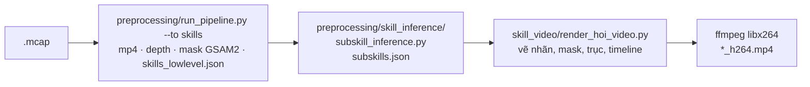

# skill_video — video gắn nhãn skill + sub-skill

Từ một video RGB-D (`.mcap`), tạo video có:

- tên **skill** đang diễn ra (Với tới, Nắm, Nhấc, Rót, Đặt xuống…) và **sub-skill** bên trong:
  - Grasp → `Approach` / `Align` / `Close_Gripper`
  - Pour → `Orient_Tilt` / `Hold_Pour_Angle` / `Return_Upright`
- mask tay (xanh) và vật (đỏ), trạng thái **đang chạm** và vị trí chạm trên vật (ví dụ "thân · chai nước");
- **trục vật**, góc nghiêng và toạ độ 3D (mm, hệ camera);
- **dải timeline** sub-skill ở dưới, tô màu theo skill cha.

Đây là cách tạo `out/mp4/demo_final_h264.mp4` trong workspace gốc. Lệnh dưới đây tái tạo đúng video đó: so từng frame được PSNR = ∞, tức giống hệt.

## Lệnh

Chạy từ gốc repo:

```bash
# Từ video .mcap (chạy luôn tiền xử lý: mp4, depth, mask GSAM2, skill)
python skill_video/make_skill_video.py video_depthcam/demo.mcap \
  --prompt "hand . plastic water bottle . white cup ."

# Hoặc dùng lại kết quả đã có của rekep_keypoint_constraints/run_pipeline.py (nhanh, ~15 s)
python skill_video/make_skill_video.py --from-run rekep_keypoint_constraints/artifacts/<name>
```

| Tham số | Mặc định | Ý nghĩa |
|---|---|---|
| `mcap` hoặc `--from-run` | — | Truyền đúng một trong hai |
| `--prompt` | — | Bắt buộc với `.mcap`: nhãn vật cho GSAM2, phải có `hand` |
| `--interval` | `1.0` | Giây giữa 2 keyframe Grounding DINO. Video `demo_final` dùng 1.0; `rekep_keypoint_constraints/run_pipeline.py` dùng 1.5 |
| `--name` | tên file | Tên ngắn, dùng đặt tên file đầu ra |
| `--out` | `skill_video/output/<name>/` | Thư mục kết quả |
| `--scale` | `2` | Phóng to khung hình |
| `--no-mask`, `--no-pose-axis` | — | Tắt tô mask, tắt vẽ trục vật và toạ độ |

Với `--from-run`, mask lấy từ lần chạy đó (dùng `interval` của lần chạy đó), nên video có thể khác đôi chút so với khi chạy từ `.mcap` với `--interval 1.0`.

## Đầu ra (`skill_video/output/<name>/`)

| File | Nội dung |
|---|---|
| `<name>_skill_video_h264.mp4` | **Video kết quả** (H.264, xem được trên trình duyệt hoặc VS Code) |
| `<name>_skill_video.mp4` | Bản gốc codec `mp4v` của OpenCV (nhiều trình phát không mở được) |
| `<name>_subskills.json` | Các đoạn sub-skill: `episodes[].subskills[] = {skill, skill_vi, start, end}` |
| `<name>_contacts_per_frame.json` | Toạ độ điểm chạm tay–vật đã vẽ ở từng frame (pixel khung gốc) |
| `upstream/` | (chỉ khi chạy từ `.mcap`) mp4 màu, depth `.npz`, mask GSAM2, `*_skills_lowlevel.json` |
| `make_skill_video.log` | Log từng lệnh con |

## Các bước bên trong



- **Skill** (`hoi_skill_inference.py`): đo hình học trên mask ở **mọi frame** (chạm tay–vật, vận tốc, độ cao so với mặt bàn, góc nghiêng). Bước này không gọi VLM, nên chạy lại cho kết quả y hệt.
- **Sub-skill** (`subskill_inference.py`): dùng **depth** để đo khoảng cách thật giữa tay và vật (`gap_mm`), vì mask 2D báo "chạm" sai khi tay còn ở trên cao vật. Ngưỡng `gap_align_mm = 40`. Pha rót được chia theo góc nghiêng của chai.
- **Vẽ** (`render_hoi_video.py`): lấy từ `visualization/render_hoi_video.py` của repo `video_pipeline`, chỉ đổi đường dẫn import sang `../preprocessing`.

## Yêu cầu riêng

- `ffmpeg` trong `PATH` để tạo bản H.264. Nếu không có ffmpeg, chỉ có bản `mp4v`.
- Font DejaVu tại `/usr/share/fonts/truetype/dejavu/` (Ubuntu: `sudo apt install fonts-dejavu-core`).
- GPU cho bước GSAM2 khi chạy từ `.mcap`. Nếu Ollama đang giữ model trong VRAM (sau khi chạy `rekep_keypoint_constraints`), bước này có thể báo `CUDA out of memory`. Khi đó giải phóng bằng `ollama stop qwen3-vl:8b-instruct; ollama stop qwen3.5:9b`.
